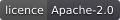
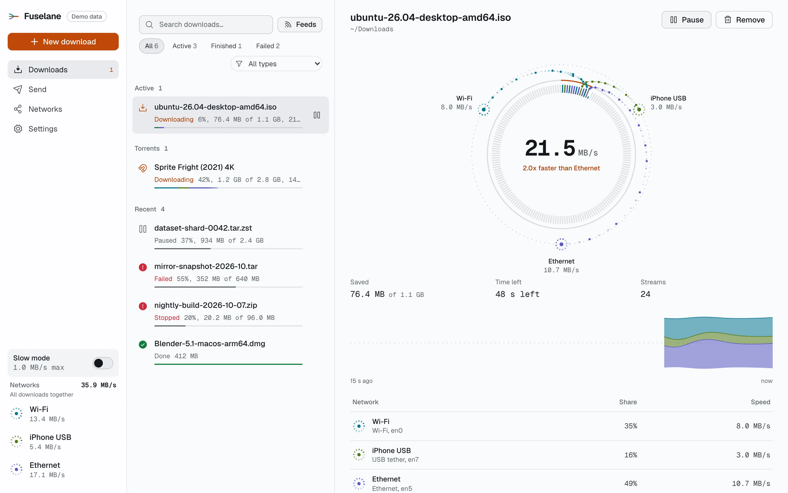
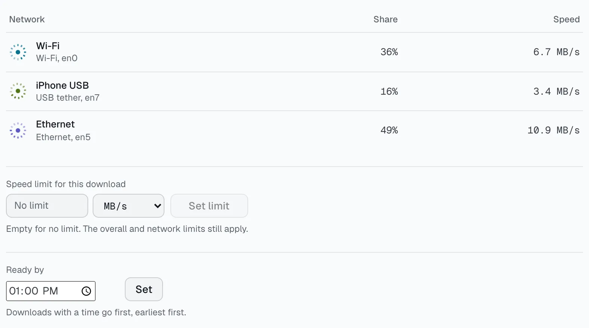
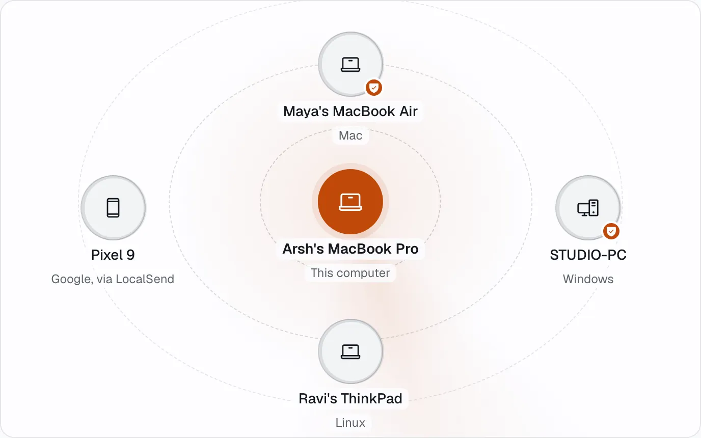
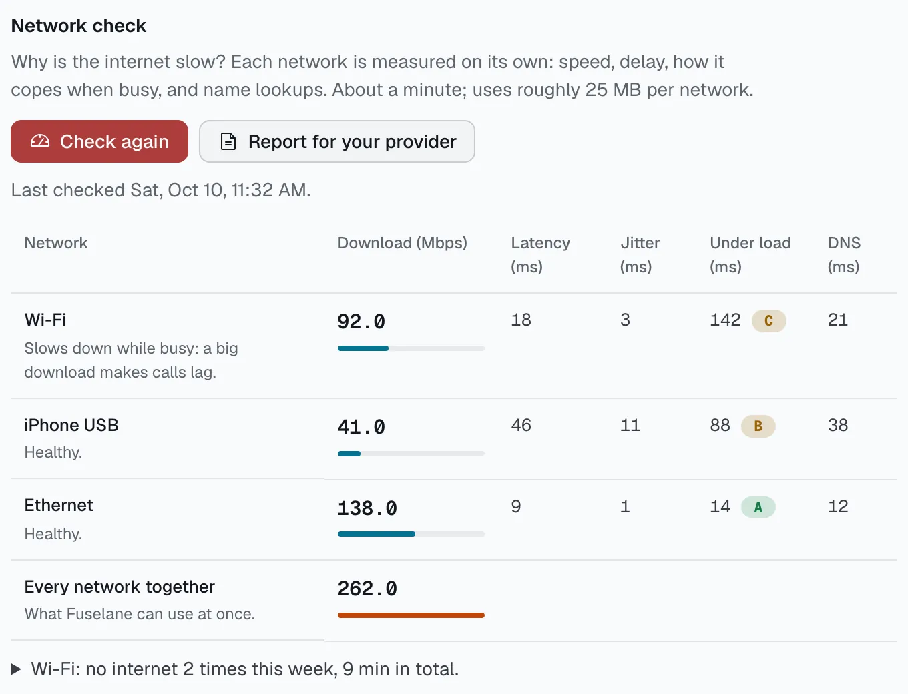
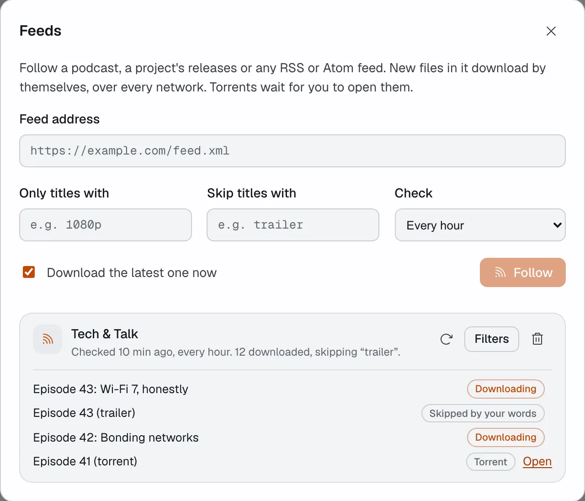
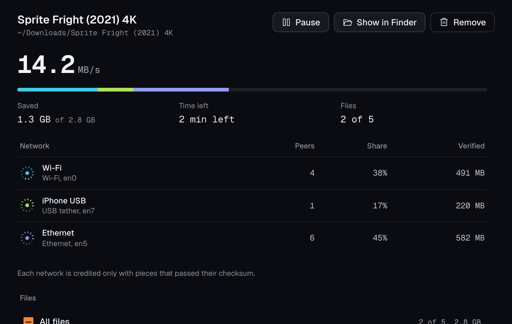
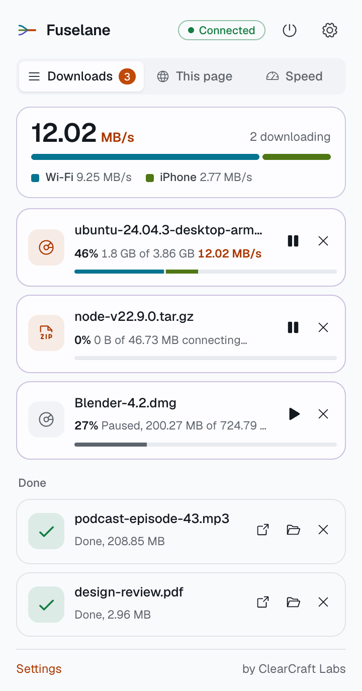
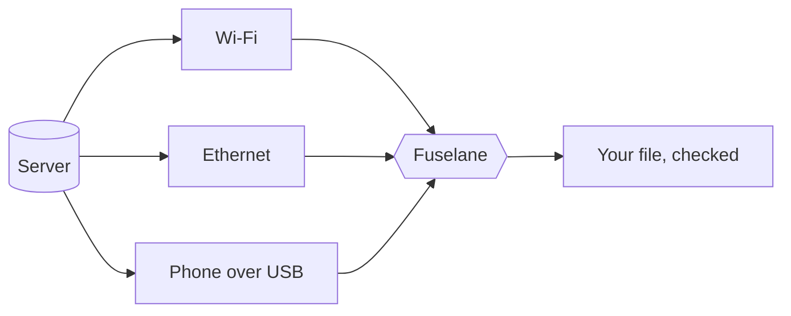

<div align="center">


# Fuselane

**Every internet connection you have, working on one download.**

Wi-Fi, Ethernet and a phone tethered over USB, at the same time. No VPN, no relay server, no admin rights.

[](https://github.com/ArshPunisher/fuselane/releases)
[](https://github.com/ArshPunisher/fuselane/actions/workflows/ci.yml)
[](LICENSE)
<br>


[](https://chromewebstore.google.com/detail/nggljghjikdkigiekdciocigdnnhponl)
[](https://microsoftedge.microsoft.com/addons/detail/aeacngcllkfecpfoclekcfhpokjhijgc)

**[Download](https://fuselane.app/download)** &nbsp;&nbsp;|&nbsp;&nbsp; **[Website](https://fuselane.app)** &nbsp;&nbsp;|&nbsp;&nbsp; **[Guide](https://fuselane.app/guide)** &nbsp;&nbsp;|&nbsp;&nbsp; **[FAQ](https://fuselane.app/faq)**

<br>

<picture>
  <source media="(prefers-color-scheme: dark)" srcset="docs/shots/app-dark.webp">
  
</picture>

</div>

<br>

## What it does

Fuselane splits each download into parts and fetches them over every network the computer has, so you get their combined speed. A slow network gets less work, a dead one hands its part to the others, and every file is checked when it finishes.

<table>
  <tr>
    <td width="50%" valign="top">
      <picture>
        <source media="(prefers-color-scheme: dark)" srcset="docs/shots/control-dark.webp">
        
      </picture>
      <h3>Every network at once</h3>
      See what each network carries, cap a download's speed, or give it a time it has to be ready by.
    </td>
    <td width="50%" valign="top">
      <picture>
        <source media="(prefers-color-scheme: dark)" srcset="docs/shots/send-dark.webp">
        
      </picture>
      <h3>Send to nearby computers</h3>
      Files, folders, text and the clipboard go straight to other computers and phones on the same network. Works with LocalSend.
    </td>
  </tr>
  <tr>
    <td width="50%" valign="top">
      <picture>
        <source media="(prefers-color-scheme: dark)" srcset="docs/shots/check-dark.webp">
        
      </picture>
      <h3>Network check</h3>
      Why is the internet slow? Each network is measured on its own, with a report you can send your provider.
    </td>
    <td width="50%" valign="top">
      <picture>
        <source media="(prefers-color-scheme: dark)" srcset="docs/shots/feeds-dark.webp">
        
      </picture>
      <h3>Feeds</h3>
      Follow a podcast, a project's releases or any RSS or Atom feed. New files download by themselves.
    </td>
  </tr>
  <tr>
    <td width="50%" valign="top">
      
      <h3>Torrents</h3>
      Magnet links and .torrent files over every network, with file choice, priorities and play while it downloads.
    </td>
    <td width="50%" valign="top">
      <picture>
        <source media="(prefers-color-scheme: dark)" srcset="docs/shots/extension-dark.png">
        
      </picture>
      <h3>Browser extension</h3>
      Downloads you start in Chrome, Edge, Brave or Firefox go to Fuselane, with the site's sign-in kept.
    </td>
  </tr>
</table>

Also: videos from web pages with your own [yt-dlp](https://github.com/yt-dlp/yt-dlp), hand a download to another computer halfway through, mirrors, schedules, data allowances per network, and a command-line tool.

## Install

| System | How |
|---|---|
| **macOS** 13.3+ | `brew install --cask arshpunisher/tap/fuselane`, or the `.dmg` from [Releases](https://github.com/ArshPunisher/fuselane/releases) |
| **Windows** 10 / 11 (x64) | `Fuselane_<version>_windows-x64-setup.exe` from [Releases](https://github.com/ArshPunisher/fuselane/releases) |
| **Linux** x64 / arm64 | `.AppImage` (x64), `.deb` or `.rpm` from [Releases](https://github.com/ArshPunisher/fuselane/releases) |
| **Command line** | `fuselane-cli_<version>_<system>` from [Releases](https://github.com/ArshPunisher/fuselane/releases) |
| **Browser** | [Chrome Web Store](https://chromewebstore.google.com/detail/nggljghjikdkigiekdciocigdnnhponl) (also Brave) and [Edge Add-ons](https://microsoftedge.microsoft.com/addons/detail/aeacngcllkfecpfoclekcfhpokjhijgc) |

<details>
<summary>macOS install script</summary>

```sh
curl -fsSL https://raw.githubusercontent.com/ArshPunisher/fuselane/main/packaging/macos/install.sh | sh
```

</details>

Every release lists `SHA256SUMS`. The app updates itself from a signed feed and sends nothing else ([privacy](docs/PRIVACY.md)).

## How it works



Each network gets its own connections, pinned to that network. Parts are handed out by speed: when a network slows down it gets smaller parts, and when one drops, its unfinished part goes to the others. Nothing passes through anyone else's server, and the server sees ordinary range requests.

## Build from source

You need Rust (see `rust-toolchain.toml`), Node 24 and pnpm 11.

```sh
pnpm install
pnpm --filter @fuselane/desktop tauri dev     # the desktop app
cargo run -p fuselane-cli -- --help           # the command-line tool
tools/check.sh                                # every check CI runs
```

See [CONTRIBUTING.md](CONTRIBUTING.md) before opening a pull request.

## Signing and trust

- Every release is built by GitHub Actions from this public repository. Nothing is built or signed on a personal machine.
- macOS builds are signed with the project's own certificate (not notarized). Windows signing through the [SignPath Foundation](https://signpath.org) is in progress, so SmartScreen may warn until then.
- App updates are signed with the project's update key and checked by the app before they install.
- Committer, reviewer and release approver: [@ArshPunisher](https://github.com/ArshPunisher).

<details>
<summary>Documentation map</summary>

| Folder | What's inside |
|---|---|
| [`docs/00-overview`](docs/00-overview) | Vision, users, positioning, principles, non-goals |
| [`docs/01-research`](docs/01-research) | Plexo analysis, market research, tech research, naming |
| [`docs/02-product`](docs/02-product) | Parity checklist, new features, lessons learned |
| [`docs/03-architecture`](docs/03-architecture) | Engine, networking, torrents, extension, security, platforms |
| [`docs/04-plan`](docs/04-plan) | Roadmap, steps, live status |
| [`docs/05-quality`](docs/05-quality) | Testing strategy and hardware matrix |
| [`docs/06-process`](docs/06-process) | Workflow, commits, branches, releases |
| [`docs/07-design`](docs/07-design) | Design system and motion |
| [`docs/adr`](docs/adr) | Architecture decision records |

</details>

## Inspiration

Fuselane was inspired by [Plexo](https://github.com/anmolkapil/plexo) (MIT), which showed that downloading over several networks without a VPN is wanted. Fuselane is a clean-room implementation in a different language (Rust) with a different design; no Plexo code is used ([ADR 0005](docs/adr/0005-clean-room-policy.md)).

## Licence

[Apache-2.0](LICENSE). Free and open source, built only on free services ([ADR 0009](docs/adr/0009-zero-cost-policy.md)). Made by [ClearCraft Labs](https://clearcraftlabs.com).
